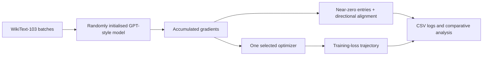

# Optimizer behaviour under sparse and changing gradients

An exploratory **17-optimizer language-model training comparison** by **Mahmoud Abo Shukr and Amira Ramzi**. The project examines training loss, near-zero gradient entries, and changes in gradient direction under a shared short-run protocol.

**Scope:** the default experiment contains **50 optimizer updates**. It studies early training behaviour; it does not establish long-run convergence or a universal optimizer ranking.

## Inspect a result first

The repository includes [recorded CSV logs](logs) and [analysis artifacts](results). For example, the archived [AdamW seed-42 run](logs/adamw_seed42.csv) records:

| Update index | Recorded training loss | Near-zero gradient entries |
| --- | --- | --- |
| 0 | 10.8272 | 16.95% |
| 20 | 3.0528 | 96.03% |
| 45 | 0.2159 | 93.03% |

These selected observations illustrate a short, fluctuating trajectory; they are not validation scores or a fresh reproduction. Consult the full CSV and revision caveat below before comparing optimizers.

Each log records:

| Field | Meaning in the current implementation |
| --- | --- |
| `step` | Zero-based optimizer-update index |
| `loss` | Training loss from the last microbatch at the logging point, rescaled after gradient accumulation |
| `sparsity` | Percentage of gradient entries with absolute value below `1e-5` |
| `drift` | Cosine similarity between the current gradient and its exponential moving-average history |
| `time_sec` | Elapsed wall-clock time |

Despite its name, `drift` is an alignment score: a smaller value means less directional agreement. The first value is initialised to 1.0. The history is updated at diagnostic logging points with EMA coefficient 0.9. Near-zero entries do not mean those parameters are permanently excluded from updates.



## Protocol

- GPT-style model configured in [src/models/gpt.py](src/models/gpt.py): 12 layers, embedding width 1,024, and 16 attention heads.
- GPT-2 tokenizer and WikiText-103 data; sequence length 1,024.
- Default seed 42, microbatch size 1, and 8 accumulation steps.
- Default learning rate `5e-4`; diagnostics every 5 updates.
- A 50-update run therefore logs indices 0, 5, …, 45.

The optimizer implementations and accepted names are defined in [src/optimizers/factory.py](src/optimizers/factory.py). They include SGD, Adam/AdamW, RMSprop, Adagrad, Adadelta, LAMB, AdaBelief, CAME, Adafactor, Lion, GaLore variants, Adam-mini, SPAM, Stable-SPAM, and AdaMem.

## Quick-start

Use a CUDA-capable environment for the supplied mixed-precision training path. The current script uses CUDA autocast; CPU execution has not been validated.

```bash
git clone https://github.com/Mahmoud-AboShukr/sparse-nonstationary-optimizers.git
cd sparse-nonstationary-optimizers
python -m venv .venv
# Linux/macOS: source .venv/bin/activate
# Windows PowerShell: .venv\Scripts\Activate.ps1
python -m pip install -r requirements.txt
python train.py --optimizer adamw --steps 50 --batch_size 1 --accum_steps 8 --lr 0.0005 --seed 42
```

The `--optimizer` argument is required. Internet access is needed for the tokenizer, dataset, and Git-based dependencies. Model, gradient, and optimizer-state memory requirements vary across optimizers; fitting one configuration does not guarantee that every optimizer fits the same GPU.

**A run overwrites `logs/<optimizer>_seed<seed>.csv`.** Copy the provided logs to a separate directory before reproducing experiments.

## Inspect your output

```python
import pandas as pd

df = pd.read_csv("logs/adamw_seed42.csv")
print(df[["step", "loss", "sparsity", "drift", "time_sec"]].tail())
```

## Scientific limits and reproducibility

- Training loss is not held-out language-model quality. Short trajectories and hand-designed composite scores should not be read as a general ranking.
- The same learning rate does not give every optimizer its best tuned setting.
- A thresholded gradient statistic depends on gradient scale and the chosen threshold.
- Archived logs and figures may reflect an earlier code revision. Record the commit, dependencies, hardware, and arguments for every new run.
- The loader pads sequences with the EOS token and clones input IDs as labels. Review attention and padding-loss masking before using this as a definitive language-model benchmark.
- A fresh full training reproduction was not performed as part of the documentation update.

## Repository guide

- [train.py](train.py): command-line experiment entry point.
- [src/data/loader.py](src/data/loader.py): data loading.
- [src/metrics/diagnostics.py](src/metrics/diagnostics.py): gradient-statistic definitions.
- [logs](logs): archived runs.
- [results](results) and [plots](plots): analysis and figures.
